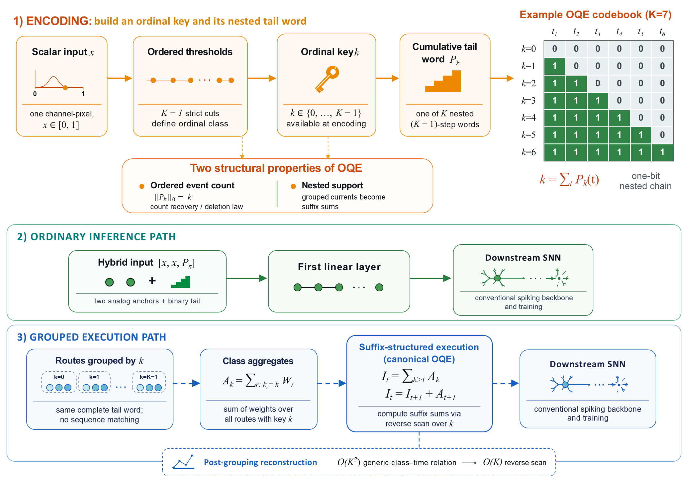

# OQE: Ordered Temporal Coding for SNN Inputs

### Exact Route Grouping and Suffix Reconstruction

Official implementation of **OQE: Ordered Temporal Coding for SNN Inputs with Exact Route Grouping and Suffix Reconstruction**, accepted at **IEEE MSN 2026**.

[Reproduction guide](docs/REPRODUCTION.md) · [Results](docs/RESULTS.md) · [Execution benchmarks](docs/CAMERA_READY.md) · [Experiment map](docs/EXPERIMENT_MAP.md)

## Overview

OQE connects a temporal input representation to its execution. Each input scalar
is mapped to an ordinal key and a cumulative binary spike word. Routes sharing
the same key can be grouped exactly, and the nested temporal supports allow
first-layer currents to be reconstructed with a suffix scan.



*Overview with a K = 7 example. The two-anchor interface is shown; anchor-free
and one-anchor configurations are also evaluated. [Vector figure](docs/assets/method_overview.pdf).*

The repository includes:

- **Ordered temporal coding:** ordinal-key construction and cumulative spike words.
- **Exact route grouping:** generic and suffix-based first-layer current reconstruction.
- **Matched controls:** direct, rate, latency, single-spike, and non-nested encodings.
- **Reproducible evaluation:** four image datasets, anchor ablations, event deletion,
  numerical-equivalence tests, and CPU/GPU deployment measurements.

The suffix scan reduces post-grouping reconstruction work from quadratic to linear
in codebook size. The measured implementation accelerates this reconstruction
stage; complete grouped forwarding still includes key preparation and aggregation
overhead and is not faster than ordinary forwarding. See the
[deployment results](docs/RESULTS.md#execution) for both measurements.

## Main results

Clean test accuracy (%), mean ± population standard deviation over three seeds.
The main protocol uses two analog anchors and six tail steps for OQE and Matched
Single-Spike (K = 7). Accuracy is evaluated with ordinary forwarding.

| Dataset | Direct | Rate | Latency | Matched Single-Spike | OQE |
|---|---:|---:|---:|---:|---:|
| Fashion-MNIST | 89.71 ± 0.09 | 86.72 ± 0.27 | 87.97 ± 0.10 | 89.37 ± 0.14 | 89.09 ± 0.23 |
| KMNIST | 91.44 ± 0.34 | 90.81 ± 0.41 | 89.48 ± 0.17 | 91.24 ± 0.33 | 91.14 ± 0.44 |
| CIFAR-10 | 79.05 ± 0.07 | 66.64 ± 0.15 | 73.94 ± 0.14 | 77.84 ± 0.31 | 76.76 ± 0.25 |
| CIFAR-100 | 45.35 ± 0.28 | 26.99 ± 0.54 | 32.22 ± 1.79 | 38.52 ± 0.70 | 38.18 ± 0.83 |

The anchor-free comparison provides a different trade-off: OQE improves mean
accuracy over the matched single-spike control by 2.18 pp on Fashion-MNIST and
2.28 pp on KMNIST, with a −0.10 pp difference on CIFAR-10. Full comparisons,
activity costs, and timing boundaries are in [Results](docs/RESULTS.md).

## Quick start

### 1. Install

Python 3.11 is recommended for installation. Run commands from the repository root.

```bash
git clone https://github.com/gbh-9/oqe-v23-reproduction.git oqe
cd oqe
python -m venv .venv
```

Activate the environment with `source .venv/bin/activate` on Linux/macOS or
`.\.venv\Scripts\Activate.ps1` in Windows PowerShell, then install:

```bash
python -m pip install --upgrade pip
python -m pip install -r requirements.txt
```

The recorded GPU benchmarks used PyTorch 2.7.1+cu118, CUDA 11.8, and an NVIDIA
GeForce RTX 4060 Laptop GPU. Match the recorded environment when comparing
absolute timing; see the [benchmark protocol](docs/CAMERA_READY.md).

### 2. Run a lightweight check

```bash
python -m pytest
```

To rebuild the joint accuracy/activity/runtime table from the included measurements:

```bash
python scripts/summarize_camera_ready.py
```

Table generation uses only the Python standard library and needs no GPU, dataset,
or trained checkpoint. Outputs are written to `results/camera_ready_tables/`;
use `--output-dir` with a new directory for subsequent runs.

### 3. Prepare data and train

```bash
python scripts/prepare_datasets.py
python scripts/run_oqe_v6_main.py --dataset fashion_mnist --arm oqe --seed 20261010
```

For the complete main comparison, including the non-nested control:

```bash
python scripts/run_oqe_v6_main.py --dataset all --arm all --include-non-nested
python scripts/summarize_oqe_v6.py
```

Datasets are downloaded under `data/`; generated checkpoints and results are
written under `results/`. Checkpoints are not bundled. Deletion studies and
full-forward benchmarks require the corresponding trained checkpoints.

## Reproduction guide

| Task | Instructions |
|---|---|
| Main classification experiments and dataset setup | [Reproduction](docs/REPRODUCTION.md) |
| Anchor counts, temporal order, codebook size, and event deletion | [Experiment map](docs/EXPERIMENT_MAP.md) |
| Five-path inference timing and GPU allocation | [Execution benchmarks](docs/CAMERA_READY.md) |
| Reported results and their source files | [Results](docs/RESULTS.md) |
| Structural checks and release verification | [Validation](docs/AUDIT_REPORT.md) |

## Repository structure

```text
src/         Encoders, matched SNN models, and grouped executors
scripts/     Dataset preparation, training, evaluation, and table generation
configs/     Readable experiment protocol manifests
reference/   Frozen numerical results and measured timing samples
tests/       Structural and numerical consistency tests
docs/        Reproduction guides, result tables, and method figures
```

Some filenames retain experiment identifiers for compatibility with recorded
checkpoints and commands; they are provenance labels, not separate paper versions.
YAML manifests document the protocols; the CLI runners are the executable interface.

## Citation

If you use this implementation, please cite **OQE: Ordered Temporal Coding for
SNN Inputs with Exact Route Grouping and Suffix Reconstruction**, IEEE MSN 2026.
The complete bibliographic entry will accompany the proceedings record.

## License

License terms are awaiting author approval; see [LICENSE_PENDING.md](LICENSE_PENDING.md).
